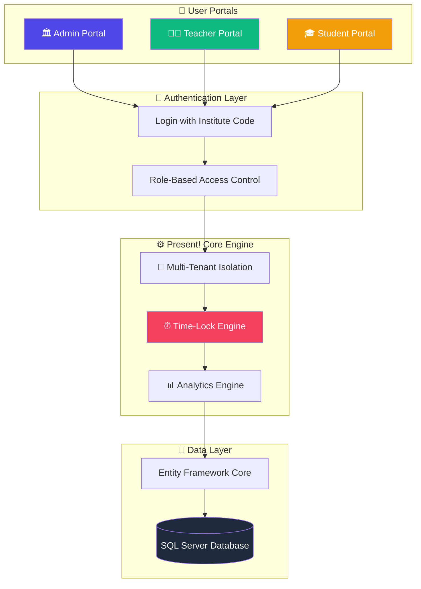
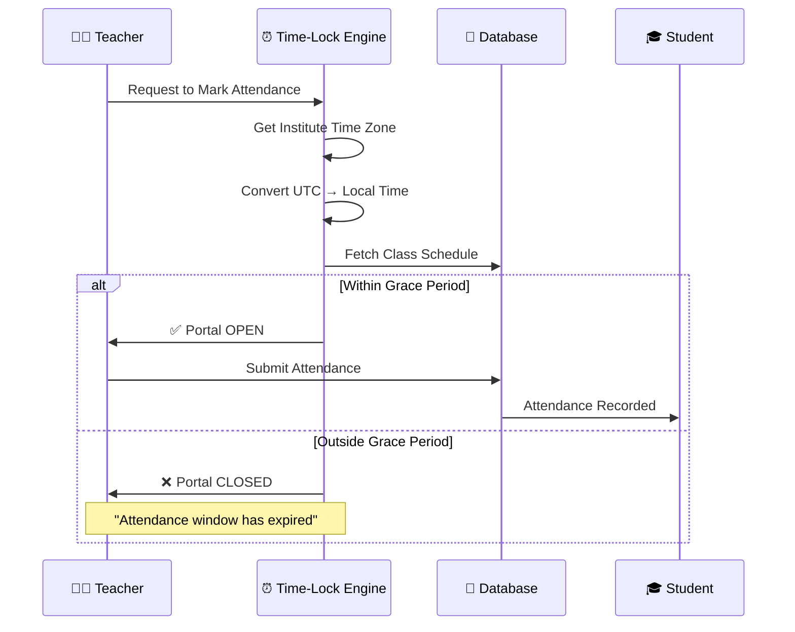

<p align="center">
  
</p>

<h1 align="center">Present!</h1>

<p align="center">
  <strong>The Smart, Time-Locked Attendance Platform for Modern Institutes</strong>
</p>

<p align="center">
  <a href="http://present.tryasp.net/">
    
  </a>
</p>

<p align="center">
  
  
  
  
  
</p>

<p align="center">
  <a href="http://present.tryasp.net/">View Live Demo</a> •
  <a href="#-key-features">Features</a> •
  <a href="#-tech-stack">Tech Stack</a> •
  <a href="#%EF%B8%8F-local-development-setup">Setup Guide</a>
</p>

---

## 🌐 Live Demo

> **Experience Present! without any installation!**

<p align="center">
  <a href="http://present.tryasp.net/">
    
  </a>
</p>

**Test Credentials:**
| Role | Email | Password | Institute Code |
|------|-------|----------|----------------|
| Admin | *Create your own* | *Sign Up* | *Auto-generated* |
| Teacher | *Created by Admin* | *Set by Admin* | *Required at Login* |
| Student | *Created by Admin* | *Set by Admin* | *Required at Login* |

> 💡 **Tip:** Start by clicking "Create Institute" to set up your own tenant and explore all features!

---

## 🏗️ Architecture



### Time-Lock Engine Flow



---

## ✨ Key Features

### 🏢 Multi-Tenancy
> **Complete data isolation for multiple institutes on a single platform.**
- Each institute operates in its own secure environment
- Institute Code required at login for tenant identification
- No cross-tenant data leakage

### ⏰ Time-Locked Attendance
> **Proprietary engine restricting attendance marking to specific class times.**
- Teachers can ONLY mark attendance during scheduled class hours
- Configurable grace period (default: 15 minutes)
- Time Zone aware (supports global institutes)
- Prevents proxy attendance and late submissions

### 🔐 Role-Based Access Control (RBAC)
> **Three distinct portals with tailored experiences.**

| Role | Capabilities |
|------|-------------|
| **Admin** | Create batches, sections, subjects, teachers, students, course offerings, schedules |
| **Teacher** | View assigned courses, mark time-locked attendance, generate reports, export to Excel |
| **Student** | View enrolled subjects, check attendance history, monitor attendance percentage |

### 📊 Smart Dashboard
> **Live, proactive status banners with real-time information.**
- 🟢 **LIVE NOW** - Active class with countdown timer
- 🟡 **UPCOMING** - Next class countdown
- 🔴 **COMPLETED** - Today's classes finished
- ⚪ **NO CLASSES** - Rest day indicator

### 📈 Reporting & Analytics
> **Comprehensive insights with one-click Excel exports.**
- Course-wise attendance reports
- Student-wise attendance history
- Visual charts using Chart.js
- Professional Excel exports via ClosedXML
- Color-coded status indicators (Green/Yellow/Red)

### 🌍 Time Zone Support
> **Global institutes, local times.**
- Configurable per-institute time zone
- Automatic UTC to local time conversion
- Windows Time Zone ID support

---

## 🛠️ Tech Stack

<table>
<tr>
<td align="center" width="150">

**Backend**

</td>
<td>

- ASP.NET Core 8.0 (MVC Pattern)
- C# 12
- Entity Framework Core 8 (Code-First)
- ASP.NET Core Identity

</td>
</tr>
<tr>
<td align="center">

**Database**

</td>
<td>

- Microsoft SQL Server 2022
- LocalDB (Development)
- Azure SQL / Hosted SQL (Production)

</td>
</tr>
<tr>
<td align="center">

**Frontend**

</td>
<td>

- Razor Views (.cshtml)
- Bootstrap 5.3
- Bootstrap Icons
- Chart.js 4.4

</td>
</tr>
<tr>
<td align="center">

**Libraries**

</td>
<td>

- ClosedXML (Excel Export)
- Google Fonts (Inter)
- jQuery

</td>
</tr>
<tr>
<td align="center">

**DevOps**

</td>
<td>

- Git & GitHub
- MonsterASP.NET (Hosting)
- IIS (Web Server)

</td>
</tr>
</table>

---

## 🛠️ Local Development Setup

### Prerequisites

Before you begin, ensure you have the following installed:

| Requirement | Version | Download |
|-------------|---------|----------|
| Visual Studio | 2022 (17.8+) | [Download](https://visualstudio.microsoft.com/) |
| .NET SDK | 8.0 | [Download](https://dotnet.microsoft.com/download/dotnet/8.0) |
| SQL Server | LocalDB / Express | Included with VS |

### Step 1: Clone the Repository

```bash
git clone https://github.com/MuhammadZainIqbal/smart-attendence-managment-system.git
cd smart-attendence-managment-system
```

### Step 2: Configure Application Settings

Create or update `appsettings.json` in the project root:

```json
{
  "ConnectionStrings": {
    "DefaultConnection": "Server=(localdb)\\mssqllocaldb;Database=PresentDB;Trusted_Connection=True;MultipleActiveResultSets=true"
  },
  "EmailSettings": {
    "SmtpServer": "smtp.gmail.com",
    "SmtpPort": 587,
    "SenderName": "Present! Attendance System",
    "SenderEmail": "your-email@gmail.com",
    "Password": "your-gmail-app-password"
  },
  "Logging": {
    "LogLevel": {
      "Default": "Information",
      "Microsoft.AspNetCore": "Warning"
    }
  },
  "AllowedHosts": "*"
}
```

> ⚠️ **Important:** For Gmail, you need an **App Password**, not your regular password.  
> [How to generate a Gmail App Password](https://support.google.com/accounts/answer/185833)

### Step 3: Setup Database

Open **Package Manager Console** in Visual Studio (`Tools > NuGet Package Manager > Package Manager Console`) and run:

```powershell
Update-Database
```

This will:
- Create the database (`PresentDB`)
- Apply all migrations
- Seed initial data (roles)

### Step 4: Run the Application

Press `F5` or click the **Run** button in Visual Studio.

The application will open at `https://localhost:xxxx`

### Step 5: Create Your First Admin Account

1. Click **"Create Institute"** on the landing page
2. Fill in:
   - Institute Name (e.g., "My University")
   - Admin Email
   - Password
3. **Verify your email** using the OTP sent
4. Note down your **Institute Code** (auto-generated, e.g., `MU-1234`)
5. Login with your credentials + Institute Code

🎉 **You're all set!** Start creating batches, sections, teachers, and students.

---

## 📖 Usage Guide

### 👨‍💼 Admin Workflow

```
1. Login → Admin Dashboard
2. Create Academic Structure:
   └── Batches (e.g., "Fall 2025")
       └── Sections (e.g., "Section A")
           └── Subjects (e.g., "CS101 - Programming")
3. Create Users:
   └── Teachers (assign courses)
   └── Students (assign batch/section)
4. Create Course Offerings:
   └── Link Teacher + Subject + Batch + Section
5. Create Class Schedules:
   └── Set Day, Time, Grace Period
6. Create Enrollments:
   └── Enroll Students in Course Offerings
```

### 👨‍🏫 Teacher Workflow

```
1. Login → Teacher Dashboard
2. View "Smart Banner" for current class status
3. When class is LIVE:
   └── Click "Mark Attendance Now"
   └── Select Present/Absent/Leave for each student
   └── Submit before grace period ends
4. Access Reports:
   └── View course analytics
   └── Export to Excel
```

### 🎓 Student Workflow

```
1. Login → Student Dashboard
2. View all enrolled subjects with attendance %
3. Click on any subject → View detailed history
4. Monitor attendance health:
   └── 🟢 Green: ≥ 85%
   └── 🟡 Yellow: 70-84%
   └── 🔴 Red: < 70%
```

---

## 📁 Project Structure

```
AttendenceManagementSystem/
├── Areas/
│   └── Identity/           # ASP.NET Core Identity
│       ├── Data/           # ApplicationDbContext, ApplicationUser
│       └── Pages/          # Login, Register, etc.
├── Controllers/
│   ├── BaseAdminController.cs      # Admin base (Multi-tenant)
│   ├── BaseTeacherController.cs    # Teacher base (Time-lock helper)
│   ├── BaseStudentController.cs    # Student base
│   ├── AdminController.cs          # Admin Dashboard
│   ├── TeacherController.cs        # Attendance Marking
│   ├── StudentController.cs        # Student Reports
│   ├── ReportsController.cs        # Analytics & Excel Export
│   └── SettingsController.cs       # Time Zone Config
├── Models/
│   ├── Institute.cs        # Tenant Entity
│   ├── Batch.cs
│   ├── Section.cs
│   ├── Subject.cs
│   ├── CourseOffering.cs
│   ├── ClassSchedule.cs
│   ├── StudentEnrollment.cs
│   └── AttendanceRecord.cs
├── ViewModels/             # DTOs for Views
├── Views/
│   ├── Admin/
│   ├── Teacher/
│   ├── Student/
│   ├── Reports/
│   └── Shared/
│       ├── _AdminLayout.cshtml    # Unified Dashboard Layout
│       └── _Layout.cshtml         # Public Layout
├── wwwroot/
│   ├── css/site.css        # Present! Design System
│   └── js/site.js
└── Program.cs
```

---

## 🤝 Contributing

Contributions are welcome! Please feel free to submit a Pull Request.

1. Fork the repository
2. Create your feature branch (`git checkout -b feature/AmazingFeature`)
3. Commit your changes (`git commit -m 'Add some AmazingFeature'`)
4. Push to the branch (`git push origin feature/AmazingFeature`)
5. Open a Pull Request

---

## 📄 License

This project is licensed under the **MIT License** - see the [LICENSE](LICENSE) file for details.

---

## 👨‍💻 Author

**Muhammad Zain Iqbal**

- GitHub: [@MuhammadZainIqbal](https://github.com/MuhammadZainIqbal)

---

<p align="center">
  <strong>⭐ If you find this project useful, please give it a star!</strong>
</p>

<p align="center">
  <a href="http://present.tryasp.net/">
    
  </a>
</p>
